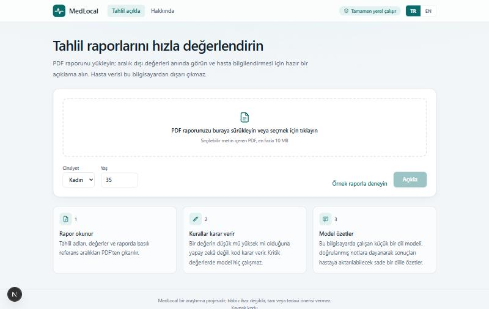
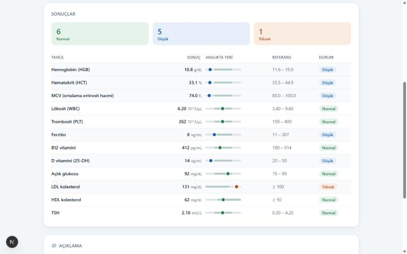
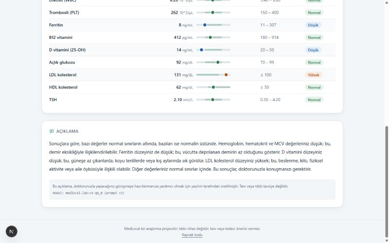
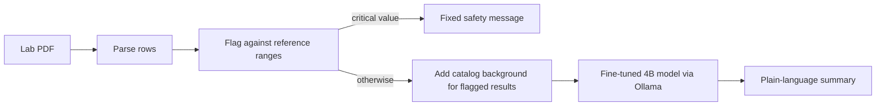

# MedLocal

A clinical support tool that helps physicians review lab reports faster — entirely on their own machine.

Upload a lab PDF. Deterministic code reads the values and flags what is out of range; a small fine-tuned language model then drafts a plain-language summary for patient communication. Nothing is sent to a cloud service, so patient data never leaves the device.

> MedLocal is a research project. It is not a medical device and does not provide diagnosis or treatment advice. The clinical decision is always the physician's.

## Demo

Upload a PDF, see out-of-range values flagged instantly, and read the model's plain-language summary:

<p align="center">
  
</p>

<p align="center">
  
</p>

<p align="center">
  
</p>

## How it works



Three rules shape the design:

- **The model never judges a number.** Whether a value is low, normal or high is decided by code, using the range printed on the report or, failing that, the catalog in [`reference/analytes.yaml`](reference/analytes.yaml). The model only puts the result into words.
- **Critical values bypass the model.** A potassium of 6.9 gets a fixed alert message and no generated text.
- **Unknown rows are shown, not guessed.** Labels the catalog does not know are listed as unrecognised and left out of the summary.

## Training the explainer

There is no public dataset of lab reports paired with patient-friendly explanations, so the training data is built locally:

1. A generator draws realistic synthetic reports from the analyte catalog (58 analytes, in English and Turkish). Values an analyser calculates from others are calculated here too, so a report never contradicts itself. No real patient data is used anywhere.
2. A larger local teacher model (Qwen3-14B, Apache 2.0) writes a summary for each report, grounded in vetted background text from the catalog.
3. Every summary must pass eleven rule-based checks. Failures are regenerated, and reports the teacher cannot get right are left out.
4. Qwen3-4B is fine-tuned on the result with QLoRA on a single 12 GB consumer GPU, then merged, converted to GGUF and served by Ollama.

The model is given the catalog's vetted background for every flagged result, at training time and in the app. It restates that text in plain language; it is not asked to recall medicine from memory.

## Results so far

**Lab explainer**, 262 held-out synthetic reports, half of them Turkish. A summary passes when it satisfies all eleven safety rules: every flagged result mentioned with the right direction, no diagnosis, no medication advice, no verdict on the patient's overall health, no condition the catalog does not name, no false alarm about a normal result, a referral to a doctor, plain text, sensible length.

| Model | English | Turkish |
|---|---|---|
| Qwen3-4B, untuned | 63.9% | 20.0% |
| Qwen3-4B + QLoRA (80 minutes on an RTX 5070) | 89.3% | 92.1% |

These numbers measure rule compliance on synthetic data, not medical accuracy. An earlier version scored 95% and still told a real patient the opposite of what the catalog says about one result; what was changed because of that, and everything else the numbers do not show, is in [`docs/results/lab-explainer.md`](docs/results/lab-explainer.md).

**Pipeline benchmark.** Before the product model, the same training and export path was proven on PubMedQA (official test split, 500 questions):

| Model | Accuracy | Macro F1 |
|---|---|---|
| Qwen3-4B, untuned | 0.596 | 0.510 |
| Qwen3-4B + QLoRA (13 minutes on an RTX 5070) | 0.764 | 0.542 |
| Same model as Q8_0 GGUF, served by Ollama | 0.766 | 0.551 |

Macro F1 moves much less than accuracy because the fine-tuned model still fails on the rare "maybe" class. That, the experiment that led to it, and a first run that scored 0.12 because of a chat-template mismatch are written up in [`docs/results/finetuned-text.md`](docs/results/finetuned-text.md).

## Repository

```
training/    Python. Synthetic data, QLoRA fine-tuning, evaluation, GGUF export.
apps/api/    NestJS. PDF parsing, reference-range rules, Ollama access.
apps/web/    Next.js. Upload, result table, streamed summary.
reference/   Analyte catalog and the prompt contract shared by training and the API.
models/      Ollama Modelfiles. Weights are not committed.
docs/        Roadmap, architecture, decisions, measured results.
```

Training and the apps share no code. They meet at the GGUF file, the Ollama HTTP API and `reference/`. [`reference/explainer-prompt.json`](reference/explainer-prompt.json) pins the exact prompt the model was trained on, and test suites on both sides compare against it, so the API cannot drift away from the training format unnoticed.

More detail: [architecture](docs/ARCHITECTURE.md), [roadmap](docs/PLAN.md) (Turkish), [decisions](docs/decisions).

## Running it

Requirements: [Ollama](https://ollama.com), Node 22 with pnpm 10. Training additionally needs an NVIDIA GPU with 12 GB of VRAM and [uv](https://docs.astral.sh/uv/).

```bash
pnpm install
cp apps/api/.env.example apps/api/.env   # set OLLAMA_MODEL to a model you have pulled
pnpm --filter api dev                    # http://127.0.0.1:3001
pnpm --filter web dev                    # http://localhost:3000
```

Open the web app and use "Örnek raporla deneyin" to try it with the bundled synthetic report.

Training commands are listed in [`CONTRIBUTING.md`](CONTRIBUTING.md) and driven by the YAML files under `training/configs/`.

## Limits

- The PDF reader handles reports with a text layer and one result per row. Scanned reports need OCR and are rejected.
- Summaries are available in Turkish and English. The Turkish text has occasional awkward phrasing inherited from the teacher model.
- Reference ranges in the catalog are typical adult values. They differ between laboratories, which is why a range printed on the report always takes precedence.
- The rule-based checks catch unsafe patterns, not every medical inaccuracy. Nothing here has been clinically validated.

## Trained model

The fine-tuned lab explainer is published and ready to use:

| Platform | Link | Command |
|---|---|---|
| Ollama | [kadirify/medlocal-lab-explainer](https://ollama.com/kadirify/medlocal-lab-explainer) | `ollama pull kadirify/medlocal-lab-explainer` |
| Hugging Face | [kadirify/medlocal-lab-4b-gguf](https://huggingface.co/kadirify/medlocal-lab-4b-gguf) | `hf download kadirify/medlocal-lab-4b-gguf` |

## Licence

[MIT](LICENSE) for the code, the analyte catalog and the synthetic dataset. Base and teacher models keep their own licences (Qwen3, Apache 2.0).
