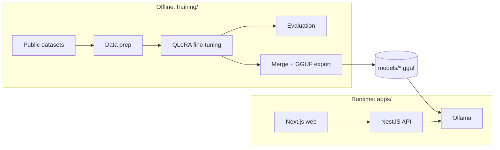

# Architecture

## System



The two halves share no code. The contract between them is the GGUF file, its Modelfile, and the prompt format the model was trained on.

## Runtime request flow

Lab report:

1. Web uploads a PDF to the API.
2. `LabReportParser` extracts analyte, value, unit.
3. Domain rules compare each value with its `ReferenceRange` and mark critical values. No model involved.
4. `ExplainLabReport` builds a prompt from the flagged results and streams an explanation through the `TextGenerator` port.
5. Response carries values, ranges, flags, explanation, disclaimer and model version.

Chest X-ray:

1. Web uploads an image.
2. API validates format and size, then calls the `ImageDescriber` port.
3. Model output is parsed into `Finding[]` plus a free-text impression; unparseable output is an error, not a result.

## Ports and adapters

| Port | Consumer | Adapter |
|---|---|---|
| `TextGenerator` | lab-report use cases | Ollama chat API |
| `ImageDescriber` | radiology use cases | Ollama chat API with images |
| `LabReportParser` | lab-report use cases | PDF text extraction |
| `ReferenceRangeRepository` | lab-report domain service | YAML file |
| `DatasetSource` | training pipeline | PubMedQA, MedMCQA, IU X-Ray, synthetic |
| `ModelExporter` | training CLI | GGUF, Hugging Face Hub |

Swapping Ollama for llama.cpp server or vLLM means writing one adapter. Adding a lab panel means adding a YAML file.

## Training pipeline

```
config.yaml -> DatasetSource -> ChatFormatter -> Trainer -> Evaluator -> ModelExporter
```

Each arrow is a typed boundary. Stages are selected by name from the config and composed in `cli.py`.

## Model choices

| Role | Model | Why |
|---|---|---|
| Text base | Qwen3-4B | fits QLoRA in 12 GB with headroom, permissive licence |
| Vision base | Qwen3-VL-4B | same family, permissive licence, trainable on 12 GB |
| Vision reference | MedGemma-4B | already trained on chest X-rays; used only as a comparison point |

Choices are revisited in Phase 1 once baseline numbers exist, and recorded in `docs/decisions/`.
