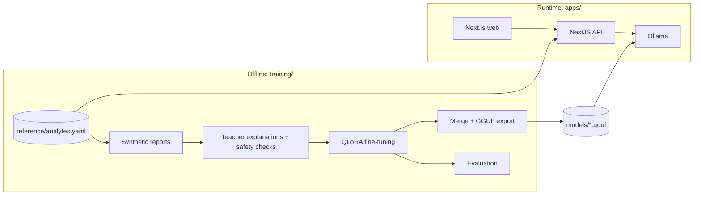

# Architecture

## System



The two halves share no code. The contract between them is the GGUF file, its Modelfile, the prompt format the model was trained on, and the analyte catalog.

## Runtime request flow

1. Web uploads a lab PDF to the API.
2. `LabReportParser` extracts analyte, value, unit and the printed reference range.
3. Domain rules compare each value with its `ReferenceRange` (the printed one, else the catalog's) and mark critical values. No model involved.
4. A critical value produces a fixed "seek medical care" message that never passes through the model.
5. `ExplainLabReport` renders the flagged results in the training prompt format and streams an explanation through the `TextGenerator` port.
6. Response carries values, ranges, flags, explanation, disclaimer and model version.

## Ports and adapters

| Port | Consumer | Adapter |
|---|---|---|
| `TextGenerator` | lab-report use cases | Ollama chat API |
| `LabReportParser` | lab-report use cases | PDF text extraction |
| `ReferenceRangeRepository` | lab-report domain service | `reference/analytes.yaml` |
| `ExplanationWriter` | dataset builder | teacher model through Ollama |
| `DatasetSource` | benchmark pipeline | PubMedQA |
| `AnswerPredictor` | benchmark evaluation | label logits (transformers), Ollama |

Swapping Ollama for a llama.cpp server or vLLM means writing one adapter. Adding an analyte or a panel means editing the catalog.

## Training pipeline

```
analytes.yaml -> SyntheticReportGenerator -> ExplanationWriter -> explanation checks -> JSONL
JSONL -> QLoRA trainer -> evaluation (rule checks, overlap with teacher) -> merge -> GGUF -> Ollama
```

Every stage is driven by a YAML file in `training/configs/` and composed in `cli.py`. PubMedQA runs through the same trainer and exporter; it is the benchmark that proved the pipeline end to end before the product model was trained.

## Model choices

| Role | Model | Why |
|---|---|---|
| Student | Qwen3-4B-Instruct-2507 | fits QLoRA in 12 GB with headroom, Apache 2.0 |
| Teacher | Qwen3-14B through Ollama | runs locally in 12 GB at 4-bit, Apache 2.0, so its outputs can be used for training |
